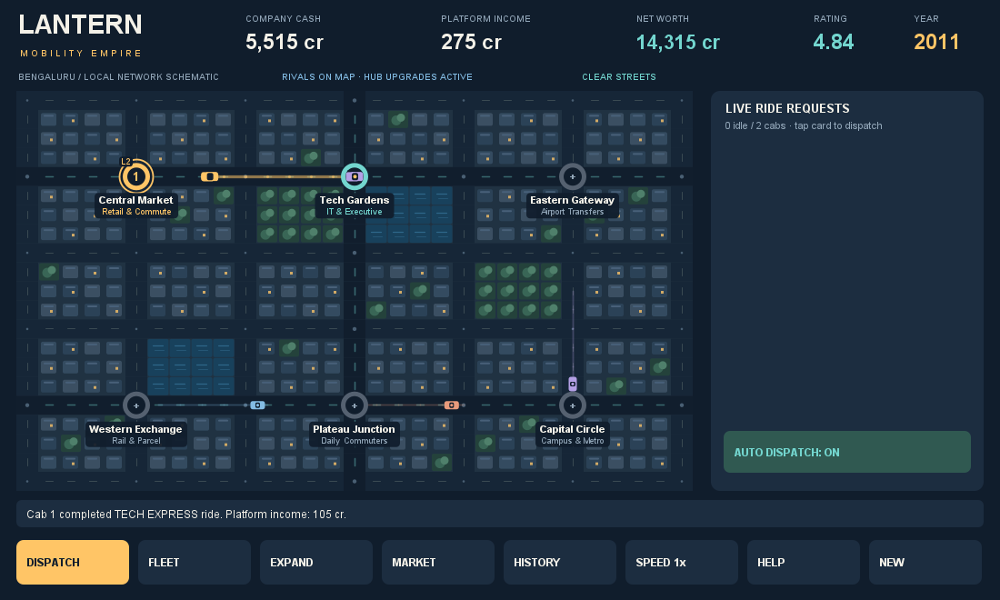

# Lantern Dispatch — Mobility Empire

### Historical newspaper update

The current WebView build includes **The Lantern Ledger**: newspaper popups that pause play, link to their sources, explain the gameplay context, and remain in a local archive. The bundled dataset currently contains 14 historical news/events across the six city campaigns and 11 historical Uber/Lyft price observations. Editions unlock against an internal calendar (50 simulated seconds per year); where a report was published after its event, the report waits until its publication date.

Finance includes a separate historical USD price archive with ticker, exchange, observation date, price type, and source. These are selected IPO prices and quarter-end closes from 2019–2021, **not a complete daily price series**. Missing dates are not interpolated. The tradable fictional rivals still use the simulation economy. Historical facts do not imply that simulated market movements occurred in the real world.

Historical text is paraphrased from linked official announcements, regulatory records, SEC filings, and one contemporaneous newspaper report. Content works offline; opening external sources requires a connection. See `assets/history-data.js` for the curated dataset. Historical editions replace the previous unsourced city timeline headlines; vehicle descriptions and tariffs elsewhere remain prototype content and have not received a full historical audit.

Run `node tests/bulletins.cjs` for newspaper/date/price checks and `node tests/journey.cjs` for chapter checks. These browser tests currently use the workstation's bundled Playwright package and Microsoft Edge. Android simulation checks run during `build.ps1`; on-device touch and lifecycle verification remains outstanding.

An original offline Android management game about building a mobility company from Bengaluru into a national network. **Lantern Dispatch is a working title, not a cleared trademark.** Version 0.2.0 is a development prototype.



All playable businesses, rival valuations, brands, artwork, layouts and economic rules are fictional. The historical campaign uses broad, documented developments in India's mobility sector. Real city names provide geographic context; the street map is an original schematic, not an actual Bengaluru road map.

## Install

Open `Lantern-Dispatch.apk` on an Android 8.0+ phone or tablet. Android may ask you to allow installation from the app that opened the file. Hold the device in landscape orientation. This is a locally signed development APK, not a store release.

No internet connection, location permission, actual booking account or real money is involved.

## Start playing

1. In DISPATCH, tap a ride request to assign the closest available driver. Or switch AUTO DISPATCH on.
2. In FLEET, recruit more partners. Each one has onboarding and ongoing operating costs.
3. In EXPAND, open more Bengaluru districts. After 20 completed rides and three local districts, use NATIONAL EXPANSION to launch other city branches.
4. In MARKET, invest in fictional competitors, use borrowed funds cautiously, and acquire controlling stakes.
5. In HISTORY, read the campaign context and distinguish facts from invented effects.

The long-term objective is six national city branches, ten driver partners and 100 rides. Play continues after the milestone. One simulated year lasts 60 game seconds; SPEED cycles 1×, 2×, 4× and pause.

Progress saves locally every 15 seconds and when the app leaves the foreground. No simulation runs while the app is closed. NEW asks before replacing your saved company. Finance menus pause the simulation; if a saved session resumes paused, use SPEED to continue.

## Systems implemented

- Original city schematic, animated cabs and road routing.
- Ride queues, pickup/drop-off phases, vehicle turnaround, traffic cycles, missed requests and reputation.
- Driver recruitment, local service territories and national branch contributions.
- Three business models: commission, corporate commute and driver subscription.
- Rival operators that earn money and compete for unassigned passengers.
- Fictional share prices, price sparklines, ownership, dividends, margin interest and forced liquidation.
- Acquisitions that integrate driver networks, rival treasury and a service territory.
- Sourced historical context from 2011–2025, with scripted historical milestones.
- Local saves and an original vector launcher icon.

The prototype does not contain a real-world map, a real booking service, actual share trading or replicas of commercial apps. No original PC-game binaries, asset packs, maps, fonts, sounds or artwork are included.

## Finance and strategy

All figures are gameplay credits (`cr`), not actual rupee prices or investment guidance. The platform records only its retained income as revenue; gross passenger fares are tracked separately.

- Commission retains 32% of fares in this simulation.
- Corporate commute unlocks in 2015, retains 40%, and has stronger peak demand but weaker off-peak demand.
- Driver subscription unlocks in 2022. It charges 80 credits per partner per 15-second quarter and takes no ride commission. It attracts more requests and can provide steadier receipts when ride demand falls.
- Each rival has 100 fictional shares. Trades use lots of ten. Acquiring a rival requires at least 60 shares, no outstanding margin debt, and payment for remaining shares at a 15% premium plus 1,200 credits integration cost.
- Buying on margin borrows 50% of purchase cost. Debt accrues 2% interest each quarter. Below 30% portfolio equity, the broker liquidates the entire portfolio; any shortfall is charged to company cash. Selling repays debt before releasing cash.
- Acquisition integrates the rival treasury, up to the 12-driver fleet limit, and a district. Driver capacity beyond the limit converts to an invented disposal value.
- National branches generate aggregate income. These are abstract regional operations, not cabs driving passengers between cities on the local map.

These rules are intentionally simplified. They are not historical brokerage regulations, present-day platform pricing or a full accounting model. Negative operating cash is allowed in this prototype; insolvency/restructuring gameplay has not yet been implemented.

## Build

Requires JDK 17, Android platform 35 and build-tools 35.0.0. No Gradle downloads or third-party game libraries are needed.

```powershell
.\build.ps1 -Sdk 'C:\path\to\Android\Sdk' -Java 'C:\path\to\jdk-17'
```

The build runs the simulation tests, compiles and packages the application, aligns it, signs it, and verifies the signature. Output: `dist/Lantern-Dispatch.apk`. Keep the development signing key in `.build/development.p12` private if you need compatible updates. Keys and generated binaries are excluded from Git.

To run just the simulation tests with JDK 17 (without Android SDK):

```sh
javac -encoding UTF-8 -d .build/tests src/com/lantern/dispatch/Game.java tests/GameTest.java
java -cp .build/tests com.lantern.dispatch.GameTest
```

## Validation

Simulation tests passed for road routing, dispatch, fare splitting, pause, funds, margin purchase/sale accounting, liquidation shortfalls, acquisitions, historical event progression, business-model gating, regional expansion, auto dispatch and one-time national objective rewards.

Four actual game drawing paths were rendered through a desktop graphics adapter for visual review. The `preview-*.png` files are **desktop layout previews**, not Android device screenshots. Basic navigation and auto-dispatch toggling were exercised through that adapter. Android compilation and APK signature checks passed.

No connected Android device or installed emulator image was available. Installation, native dialogs, lifecycle saves, touch usability, different screen sizes and prolonged performance still require on-device testing. This remains a prototype rather than a production-ready release.

## Release preparation

The source package is independent of the earlier archive analysis and contains no original game data. Before publication, clear the final game/fictional company names, review the final visuals and marketing, test devices, prepare store disclosures and complete an IP review. Fictional names and original code reduce copying risk; they do not guarantee that no third-party claim is possible.
